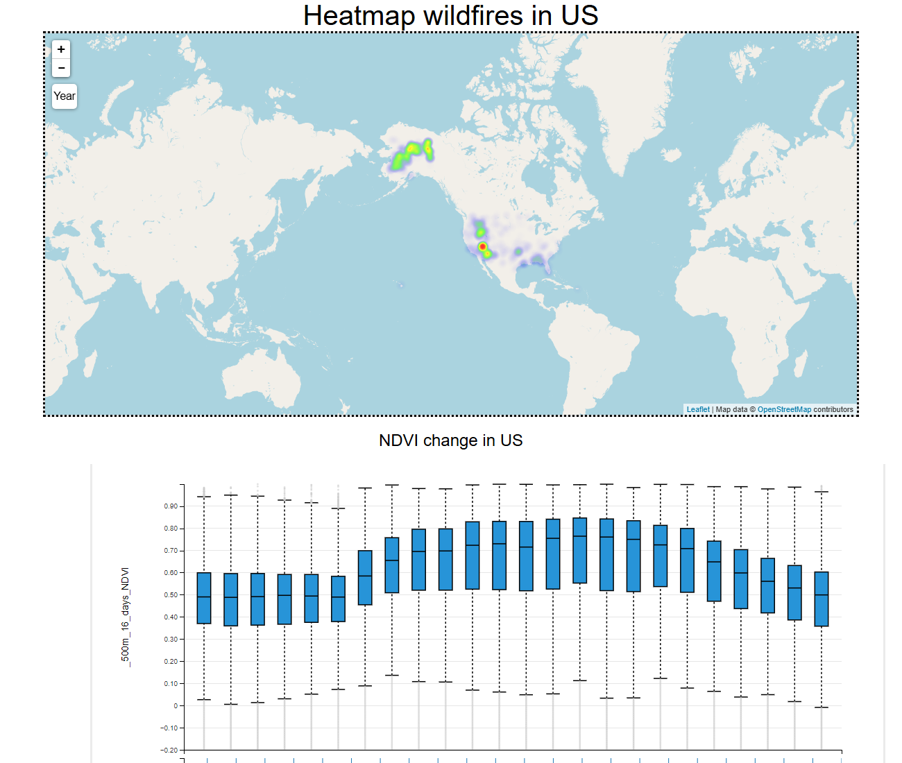
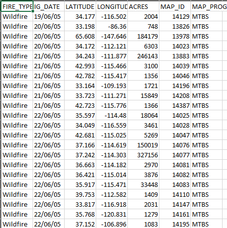
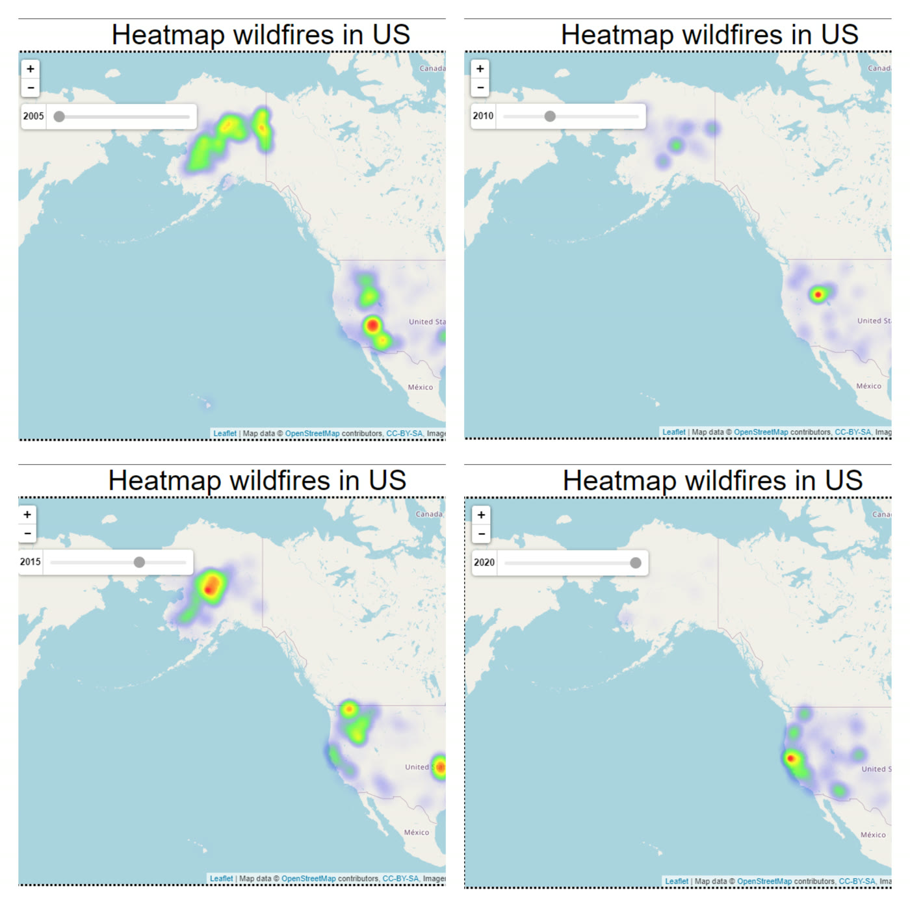
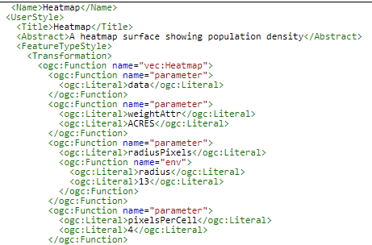
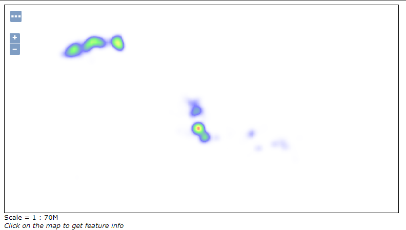
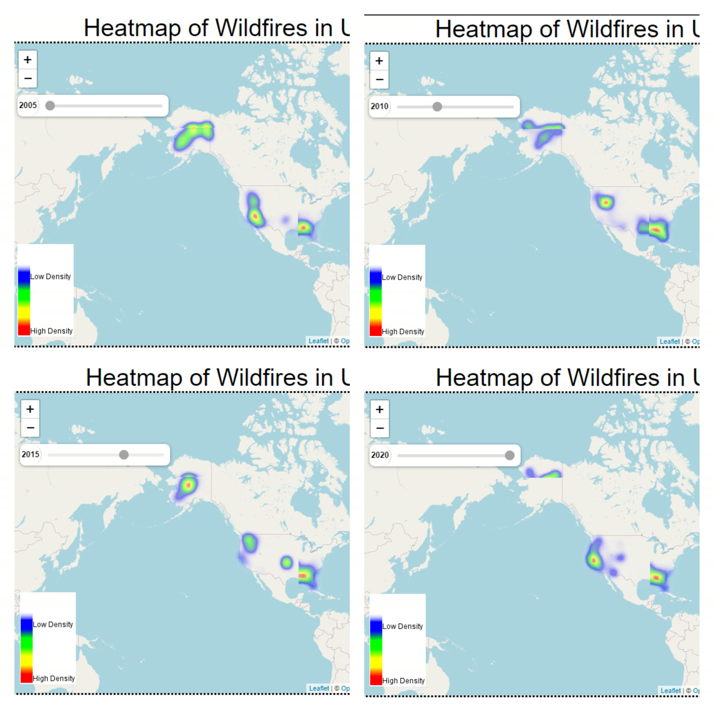
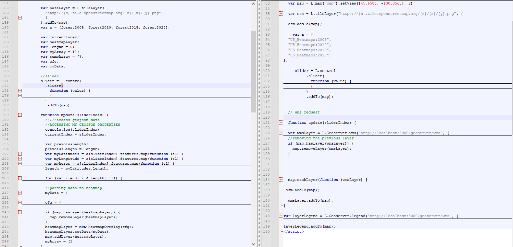
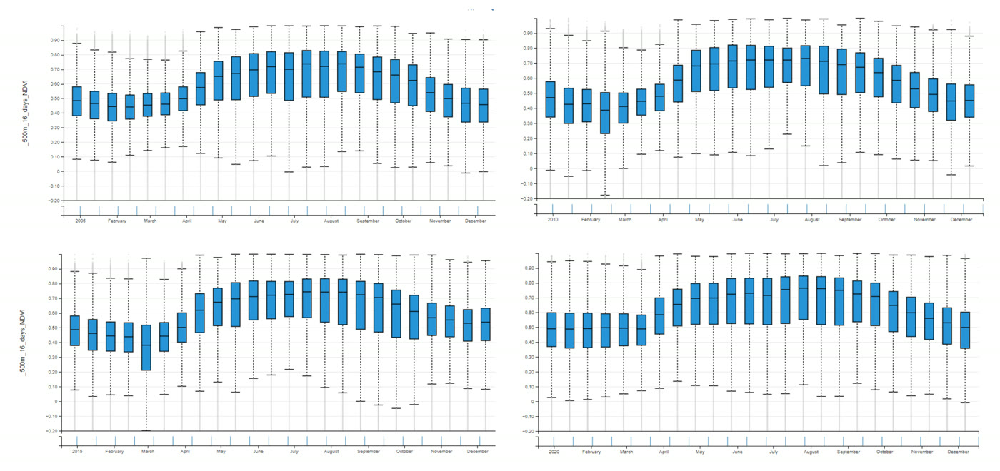

# US Wildfires: Web GIS Heatmaps & NDVI (2005–2020)

A Web GIS project that maps **wildfires across the United States** for 2005, 2010, 2015 and 2020
and compares them with **vegetation (NDVI)**. The same data is visualised in three ways:
in **QGIS**, as an interactive web map built with **Leaflet and GeoJSON**, and as a web map served
by **GeoServer**.

Semester project for *Web GIS*, BS Space Science, Institute of Space Technology (2023).
By **Muhammad Arbab Tahir**.

**[Open the live map](https://arbab-boby.github.io/us-wildfires-web-gis/)** · 📄 [Project report (PDF)](docs/report.pdf)

## The data

- **Wildfires:** the *Monitoring Trends in Burn Severity* (MTBS) dataset from the
  [USDA Forest Service](https://data.fs.usda.gov/geodata/edw/datasets.php?xmlKeyword=Monitoring+Trends+in+Burn+Severity).
  Each fire has its location, date, type and **acres burnt**. Covers the continental US, Alaska,
  Hawaii and Puerto Rico: **1,010 fires in 2005, 1,156 in 2010, 1,150 in 2015 and 813 in 2020**.
- **Vegetation:** 16-day **MODIS NDVI** (500 m) for the same areas, extracted with
  [NASA AppEEARS](https://appeears.earthdatacloud.nasa.gov/).

## Three ways to visualise the same data

### 1. QGIS
The shapefile was loaded into QGIS and styled with **heatmap symbology**, using **acres burnt** as
the weight, so bigger fires count more.

### 2. Web map with Leaflet + GeoJSON (live)
The fires for each year were exported as **GeoJSON** and drawn as a heatmap with **Leaflet** and the
**heatmap.js** plugin. A **year slider** switches between 2005, 2010, 2015 and 2020, and an NDVI
slideshow runs underneath. This version is the live map above, because it needs no server.

### 3. Web map with GeoServer
The shapefiles were published on a local **GeoServer** with a heatmap style (an SLD
*rendering transformation* weighted by acres burnt). Leaflet then requests each year as a
**WMS** layer, with a legend served by GeoServer.

| GeoServer heatmap style | GeoServer's built-in preview |
|---|---|
|  |  |

**Comparing the code.** The Leaflet version builds the heatmap in the browser from the GeoJSON data.
The GeoServer version only asks the server for a ready-made image layer. That makes it easy to
serve very large datasets, but GeoServer has to be running.

## NDVI and wildfires

Vegetation rises from **mid-March to mid-July** and falls afterwards, in every year studied.
Fires cluster in the same regions year after year, especially **Alaska** and the **southwest US**,
which suggests that local climate conditions drive where wildfires happen.

## Findings
- Hotspots repeat in the same places across 2005–2020.
- The three methods give slightly different-looking maps because of different settings for
  radius, pixels per cell and opacity.
- GeoServer handles large data easily, but needs a running server. The GeoJSON + Leaflet version
  can be hosted anywhere as a static page.

## Repository contents

| Path | What it is |
|---|---|
| [index.html](index.html) | The live Leaflet + GeoJSON web map, with `script/`, `wildfires_data/` and `ndvi/` |
| [geoserver/](geoserver/) | The GeoServer version. It needs GeoServer running at `localhost:8080` with the `US_Heatmaps` layers |
| [extras/turf-drawing-tools.html](extras/turf-drawing-tools.html) | A smaller Leaflet exercise: drawing and editing shapes with Leaflet.pm and Turf.js |
| [docs/report.pdf](docs/report.pdf) | The full project report |

## Run it yourself
Download the repository and open `index.html` in a browser. If the heatmap doesn't load, run
`python -m http.server` in this folder and open `http://localhost:8000`.

## Built with
Leaflet · heatmap.js · Leaflet Slider · GeoServer (WMS, SLD) · QGIS · NASA AppEEARS ·
HTML, CSS, JavaScript

Third-party scripts included: [heatmap.js](https://www.patrick-wied.at/static/heatmapjs/) by
Patrick Wied (MIT), and `geoserver/lib/L.Geoserver.js` from
[leaflet-geoserver-request](https://github.com/iamtekson/leaflet-geoserver-request) by Tek Kshetri (MIT).
